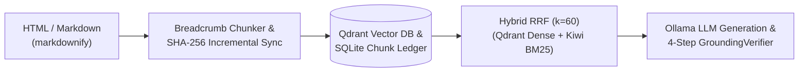

# citeguard

웹에서 수집한 약관과 운송 규정을 Qdrant 벡터 데이터베이스에 증분 적재하고, 로컬 Docker LLM(`Ollama`)이 생성한 답변의 원문 인용과 숫자 일치 여부를 검증해 반환하는 Hybrid RAG 서버 및 CLI 도구입니다.

## 검색 및 검증 파이프라인



```text
citeguard/
├── scraper.py        markdownify 기반 HTML 노이즈 제거 및 표 보존 마크다운 변환기
├── chunker.py        상위 제목 경로(Breadcrumb) 보존 청킹 및 SHA-256 해시 계산기
├── indexer.py        변경 청크 증분 임베딩 및 삭제된 구버전 Qdrant 포인트 소거 엔진
├── qdrant_store.py   AsyncQdrantClient 래퍼 및 인메모리 폴백 벡터 저장소
├── retriever.py      Qdrant Dense + kiwipiepy, rank-bm25 결합 RRF(k=60) 검색기
├── grounding.py      인용 청크 실존, 원문 스팬 포함, 숫자 단어 경계 일치 4단계 검증기
├── ollama_client.py  tenacity 지수 백오프 기반 로컬 Ollama 임베딩 및 생성 클라이언트
├── eval.py           Golden QA 기준 Recall@K, MRR, Grounding Pass Rate 평가기
├── api.py            FastAPI 서버 및 prometheus-client 메트릭 엔드포인트
└── cli.py            Typer 기반 CLI (serve, sync, ask)
```

## 주요 구현 내용

### Breadcrumb 청킹 (`scraper.py`, `chunker.py`)
약관이나 운임 규정 문서를 글자 수 단위로만 자르면 표와 상위 조항 제목(`제17조 청약철회등`)이 떨어져 나가 엉뚱한 문단이 검색됩니다. `markdownify`와 정규식으로 `<script>`, `<nav>`, `<footer>`를 제거하고 `<table>`을 마크다운 표로 바꾼 뒤, 모든 청크 앞에 `[전자상거래 표준약관 > 제4장 > 제17조]` 형태의 상위 제목 경로를 붙여 문맥이 유지되도록 했습니다.

### SHA-256 증분 동기화 (`indexer.py`)
약관 개정 시 전체 문서를 재임베딩하거나 삭제된 구버전 벡터를 남겨두면 폐지된 규정이 검색될 수 있습니다. 기존 `DocumentChunk.chunk_hash`와 해시가 같은 청크는 로컬 `Ollama` 임베딩 호출과 Qdrant 업서트를 건너뛰고(`skipped_chunks`), 새로 생겼거나 수정된 청크만 적재(`added_chunks`)하며, 새 문서에서 빠진 구버전 청크의 `qdrant_point_id`는 즉시 삭제(`purged_chunks`)합니다.

### Kiwi + Qdrant RRF 하이브리드 검색 (`retriever.py`)
Dense 벡터 검색만으로는 `'제18조의2'`나 `'AREX-11000'` 같은 정확한 조항, 코드를 구분하기 어렵습니다. 카테고리, 언어, 출처 등급(`A/B/C`), 시행일 조건으로 후보를 먼저 거른 뒤 Qdrant Dense 벡터 순위($r_{\text{dense}}$)와 `kiwipiepy` 형태소 분석 기반 `rank-bm25` 순위($r_{\text{bm25}}$)를 $\text{RRF}(d) = \frac{1}{k + r_{\text{dense}}(d)} + \frac{1}{k + r_{\text{bm25}}(d)}$ ($k=60$)로 합산합니다.

### 숫자 단어 경계 검증 (`grounding.py`)
소형 로컬 모델(`qwen2.5:0.5b` 등)은 원문에 `'7일 이내'`라고 적혀 있어도 `'14일 이내'`처럼 숫자를 지어내는 경우가 잦습니다. `GroundingVerifier`는 LLM의 JSON 응답에서 `chunk_uid` 실존 여부, `quote` 원문 부분 문자열 일치 여부, 답변 속 모든 숫자(`(?<!\d)\d+(?:,\d{3})*(?:\.\d+)?(?!\d)`)의 원문 숫자 집합 포함 여부를 검사합니다. 하나라도 어긋나면(`NUMERIC_HALLUCINATION` 등) 생성 답변을 버리고 1순위 청크 원문을 발췌한 요약(`FALLBACK_EXTRACTIVE`)을 반환합니다.

## 설치 및 CLI/서버 실행

### 로컬 Docker 스택 기동 (`Qdrant` + `Ollama`)

```bash
docker compose up -d
bash scripts/init_ollama.sh
```

기본 설정으로 `qdrant/qdrant`(포트 `6333`)와 `ollama/ollama`(포트 `11434`)가 기동하며, 임베딩 모델 `all-minilm`(45MB)과 생성 모델 `qwen2.5:0.5b`(397MB)를 내려받습니다.

### CLI 사용 (`typer`)

```bash
# 로컬 파일이나 공식 웹 URL을 Qdrant에 증분 동기화
citeguard sync \
  --doc-key ftc-standard \
  --title "전자상거래 표준약관" \
  --category commerce_policy \
  --file ./policy.md

# 하이브리드 검색 + 로컬 LLM 답변 생성 + 근거 검증
citeguard ask "청약철회는 며칠 이내에 가능한가요?" --category commerce_policy
```

### FastAPI 서버 실행

```bash
citeguard serve --host 127.0.0.1 --port 8090
```

- `POST /v1/documents/sync`: 문서 수집, 청크 해시 비교, 변경분 임베딩 및 Qdrant 업서트/삭제
- `POST /v1/search`: `hybrid`, `dense_only`, `bm25_only` 모드별 검색 및 RRF 점수 조회
- `POST /v1/ask`: 하이브리드 검색 후 로컬 LLM 생성 및 `GroundingVerifier` 검증 결과 반환
- `POST /v1/eval`: Golden QA 기준 `Recall@K`, `MRR`, `Grounding Pass Rate` 측정
- `GET /metrics`: 적재/생략/삭제 청크 수 및 검증 상태(`GROUNDED`, `FALLBACK_EXTRACTIVE`, `ABSTAINED`) Prometheus 메트릭 노출

## 평가 및 테스트

```bash
make check
```

Golden QA 평가는 `eval.py`와 `POST /v1/eval` 엔드포인트에서 수행합니다. 현재 파서는 HTML과 마크다운 텍스트를 대상으로 동작하며(PDF/OCR 미포함), 숫자 검증기는 원문에 없는 숫자 생성을 걸러내지만 원문 내 두 숫자의 대소 관계를 반대로 서술하는 문맥 오류까지는 판별하지 않습니다. BM25 역색인은 필터링된 후보 청크 집합 위에서 메모리 연산으로 동작하므로 수백만 청크 규모에서는 외부 역색인 엔진 분리가 필요합니다.
